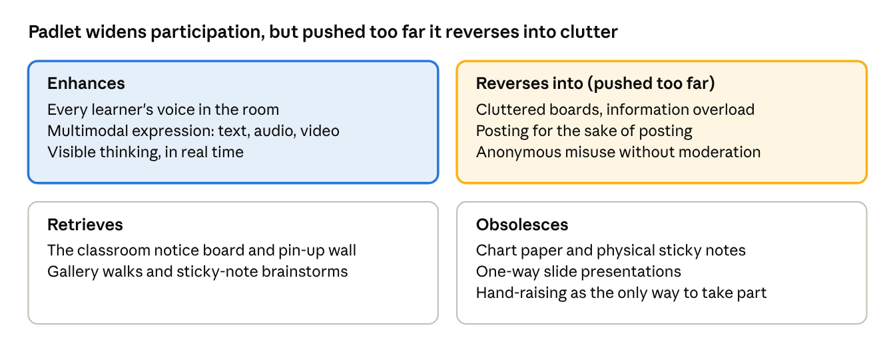

# Padlet in the Classroom: An Open Teacher's Toolkit

**Author:** Jyoshna Reddy Annapureddy · **Licence:** [CC BY 4.0](LICENSE.md) · **Version:** 1.0 (October 2026)

This toolkit gives any teacher six ready-to-run Padlet activities, a setup guide and a safety checklist. It is free to use, adapt and share under a Creative Commons licence.

## About this resource

**Who it is for:** school teachers (Grades 6–12), teacher educators and student teachers who want to use Padlet for more than collecting feedback.

**What it grew from:** a peer presentation on Padlet in the MA Education and Technology programme at TISS. The activities answer what 11 peers asked for in their feedback: exit tickets, student work examples, other formats and features, uses for teacher trainers, McLuhan's Tetrad and limitations.

**Licence:** Creative Commons Attribution 4.0 International ([CC BY 4.0](https://creativecommons.org/licenses/by/4.0/)). You may copy, adapt and share it, including commercially, as long as you credit the author.

**Suggested credit:** "Padlet in the Classroom: An Open Teacher's Toolkit" by Jyoshna Reddy Annapureddy, licensed under CC BY 4.0.

### How it meets the renewable assessment criteria

| Criterion              | How this toolkit meets it                                                                                        |
|------------------------|------------------------------------------------------------------------------------------------------------------|
| Useful after the class | Teachers can run any activity tomorrow; each one has a prompt, steps, an assessment idea and accessibility notes |
| Publicly available     | Published openly online (see *Reuse, remix and contribute*) so anyone can find it without a login                |
| Openly licensed        | CC BY 4.0, so others can adapt it for their subject, grade or language and republish it                          |

## Padlet quick start

A Padlet is a shared online board; learners add posts to it and the teacher controls who can post and what appears.

| Term             | What it means                                                            |
|------------------|--------------------------------------------------------------------------|
| Padlet (board)   | A shared online board where a group posts and organizes ideas            |
| Post             | One contribution: text, link, image, video, audio, drawing, file or poll |
| Format           | The board's layout: Wall, Grid, Stream, Columns, Timeline, Map or Canvas |
| Section / column | A heading that groups related posts, e.g. one column per topic or group  |
| Reactions        | Like, vote, star or grade a post                                         |
| Comments         | Threaded replies under a post, used for peer feedback                    |
| Moderation       | The owner approves posts before they appear                              |

### Set up a board in five steps

1.  **Create** a board and choose the format that fits the activity (see the activity cards below).

2.  **Write the prompt** as the board title and add a pinned post with instructions and an example.

3.  **Set permissions:** who can post, whether names show, whether comments and reactions are on, and whether posts need approval.

4.  **Share** the link or QR code; test it from a student device first.

5.  **Close the loop:** discuss themes in class, then export the board (PDF, image or CSV) as a record.

Padlet's features and free-plan limits change often; check the [Padlet Help Centre](https://padlet.help/) before planning a large rollout.

## Six ready-to-use activities

Each card works in any subject; swap the example prompt for your own topic.

| \#  | Activity                      | Best for                                | Format      | Time        |
|-----|-------------------------------|-----------------------------------------|-------------|-------------|
| 1   | Three-column exit ticket      | Formative check at the end of a lesson  | Columns     | 5 min       |
| 2   | I see, I think, I wonder      | Reflection on an artefact or experiment | Columns     | 15 min      |
| 3   | KWL launch board              | Prior knowledge before a unit           | Columns     | 10 min      |
| 4   | Student work gallery          | Peer review and improvement             | Grid        | 1–2 lessons |
| 5   | Debug wall (Computer Science) | Learning from errors in code            | Wall        | 20 min      |
| 6   | Share-a-practice wall         | Teacher training and PD                 | Grid or Map | 30 min      |

### 1. Three-column exit ticket

- **Prompt:** "One thing I learned · One thing I'm unsure about · A question for next class"

- **Steps:** students add one post per column in the last 5 minutes; posts can be anonymous to the class but visible to the teacher.

- **Assessment:** scan the "unsure" column to plan a 5-minute recap; use the Grade reaction or a short comment to acknowledge strong answers.

- **Accessibility:** allow audio posts and sentence starters ("Today I learned that…").

### 2. I see, I think, I wonder

- **Prompt:** pin a video, image or experiment; students respond in three columns: *I see* (observations), *I think* (explanations), *I wonder* (new questions).

- **Steps:** keep one board per unit and add a column each month so students build a record of learning over time.

- **Assessment:** look for movement from description (*see*) to explanation (*think*); use the *wonder* column to plan inquiry.

- **Accessibility:** audio reflections suit language learners; allow home languages and offer a script to scaffold.

### 3. KWL launch board

- **Prompt:** "What I **K**now · What I **W**ant to know · What I **L**earned"

- **Steps:** fill K and W at the start of a unit; return to L at the end and connect it to a W post with a comment.

- **Assessment:** compare K and L posts to show growth; W posts reveal misconceptions to address.

- **Accessibility:** let students react (vote) to a peer's post if writing is a barrier.

### 4. Student work gallery

- **Prompt:** "Post your draft with one line on what you want feedback on."

- **Steps:**

  1.  Each student posts work (image, short screen recording or file).

  2.  Peers comment on at least two posts using *two stars and a wish*.

  3.  Students reply to comments and post an improved version.

  4.  The teacher picks examples to discuss in class.

- **Assessment:** grade the improved version and the quality of feedback given.

- **Accessibility:** turn on moderation; agree feedback norms before posting.

### 5. Debug wall (Computer Science)

- **Prompt:** "Post a screenshot of an error you met this week, what caused it and how you fixed it."

- **Steps:** students post a screenshot plus three lines: *error*, *cause*, *fix*; peers star posts that helped them.

- **Assessment:** check whether the cause is explained, not just the fix; recurring errors become a class mini-lesson.

- **Accessibility:** accept a typed error message where screenshots are hard; a class glossary post defines key terms.

### 6. Share-a-practice wall (teacher training)

- **Prompt:** "Share one strategy that worked in your classroom this month: what, for whom, and evidence it worked."

- **Steps:** participants post before the workshop; the facilitator groups posts into sections and uses them to open the session. Map format works for teachers across schools or regions.

- **Assessment:** participants comment on one strategy they will try and report back next session.

- **Accessibility:** allow a 1-minute video or audio post instead of writing.

## From posting to meaningful collaboration

A board full of posts is not yet learning; five design moves turn posting into collaboration.

1.  **Purposeful prompt** — ask for reasoning or evidence, not just an answer.

2.  **Build on a peer** — each learner replies to one post and adds a new idea.

3.  **Structure the board** — sections or columns keep ideas organized and readable.

4.  **Safe space** — agree norms, moderate posts and allow anonymity with care.

5.  **Close the loop** — the teacher synthesises themes in class and learners reflect on what changed.

## Safety, privacy and accessibility checklist

Run this checklist before sharing any board with students.

- [ ] Board privacy set to *secret* or *password* rather than public
- [ ] Students do not post full names, photos of faces or personal details
- [ ] Use matches your school's data and age policies (and parental consent where needed)
- [ ] Moderation (post approval) and the profanity filter are on for younger classes
- [ ] Class norms for posting and commenting agreed and pinned on the board
- [ ] Anonymous posting decided deliberately, with a plan for misuse
- [ ] Audio, video or typed options offered so every learner can contribute
- [ ] Board kept short or split into sections so screen-reader users can navigate it
- [ ] Low-bandwidth or offline alternative ready (paper slips, then photograph them)
- [ ] Board exported or archived at the end of the unit

## Critical lens: McLuhan's Tetrad and limitations

Padlet amplifies participation, but its value depends on the learning design around it, not the tool alone.

Top row: what Padlet adds (blue) and what overuse turns it into (amber). Bottom row: what it revives and what it replaces.

| Limitation                                    | What to do about it                                               |
|-----------------------------------------------|-------------------------------------------------------------------|
| Needs internet, devices and digital readiness | Keep a paper fallback; pair students on shared devices            |
| Free plan limits the number of boards         | Reuse boards by clearing or archiving them; check school licences |
| Large groups create cluttered boards          | Use sections, cap posts per student, split into group boards      |
| Posts stay shallow without a clear prompt     | Ask for reasoning or evidence; require a reply to a peer          |
| Anonymous posts can be misused                | Turn on moderation; anonymity visible to the teacher only         |
| Privacy and age rules vary by school          | Check policy and consent before use; no personal details in posts |
| Hard to judge individual depth of learning    | Pair the board with a short individual reflection or conversation |
| Long walls are hard for screen-reader users   | Keep boards short, use Stream or Columns, add alt text to images  |

## Reuse, remix and contribute

Anyone may copy and adapt this toolkit; the only condition is credit to the author under CC BY 4.0.

**Where it is published:**

- This GitHub repository (Markdown, PDF and Word versions), open to suggestions through issues and pull requests
- The same content as a website through GitHub Pages
- Downloads: [PDF](docs/Padlet_in_the_Classroom_Toolkit.pdf) · [Word](docs/Padlet_in_the_Classroom_Toolkit.docx)

**Ways to adapt it:** translate the prompts into another language, swap examples for your subject, or add an activity card in the same format (prompt, steps, assessment, accessibility).

**To contribute:** open an issue or pull request on the GitHub repository, or fork the repository and adapt it. Contributions are released under the same CC BY 4.0 licence.

## References and attribution

- McLuhan, M., & McLuhan, E. (1988). *Laws of media: The new science*. University of Toronto Press.

- Ritchhart, R., Church, M., & Morrison, K. (2011). *Making thinking visible*. Jossey-Bass. (Source of the *See, Think, Wonder* routine.)

- Ogle, D. M. (1986). K-W-L: A teaching model that develops active reading of expository text. *The Reading Teacher, 39*(6), 564–570.

- Wiley, D., & Hilton, J. (2018). Defining OER-enabled pedagogy. *International Review of Research in Open and Distributed Learning, 19*(4).

- [Padlet](https://padlet.com/) and the [Padlet Help Centre](https://padlet.help/), for features and settings.

- [Creative Commons Attribution 4.0 International](https://creativecommons.org/licenses/by/4.0/).

- Peer feedback from the 2026 ETE presentations, MA Education and Technology, TISS.

Padlet is a trademark of Wallwisher, Inc.; this toolkit is independent and not endorsed by Padlet.
